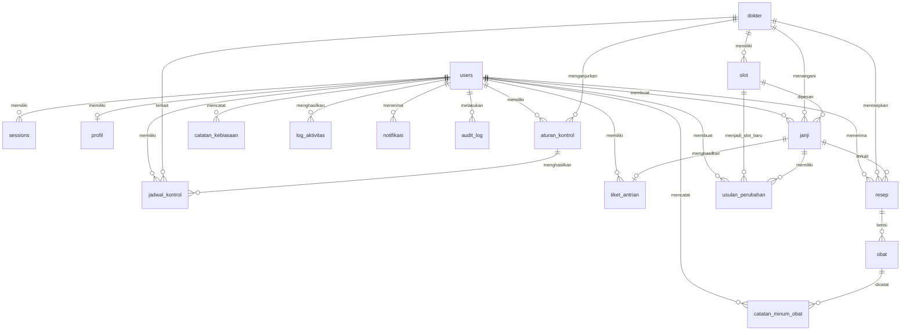

# Skema Database

Status: dokumentasi skema Drizzle saat ini  
Tanggal: 31 Oktober 2026  
Sumber kode: `src/db/schema/auth.ts`, `src/db/schema/klinik.ts`,
`src/db/schema/pasien.ts`  
Database: PostgreSQL melalui Drizzle ORM

Dokumen ini mendokumentasikan skema yang ada di kode. Nama kolom menggunakan
snake_case karena mengikuti nama database. Nama properti TypeScript memakai
camelCase.

## 1. Ringkasan

Skema terdiri dari 18 tabel dalam tiga kelompok:

- **Auth:** `users`, `sessions`
- **Klinik:** `dokter`, `slot`, `janji`, `usulan_perubahan`, `notifikasi`,
  `audit_log`, `aturan_kontrol`
- **Pasien:** `profil`, `jadwal_kontrol`, `tiket_antrian`,
  `catatan_kebiasaan`, `resep`, `obat`, `catatan_minum_obat`, `log_aktivitas`,
  `konten_statis`

Nomor antrean estimasi tidak disimpan sebagai kolom. Nilai tersebut diturunkan
saat runtime. Nomor antrean final disimpan setelah pasien melakukan check-in.

## 2. Diagram relasi

Keterangan kardinalitas:

- `||--o|`: satu ke nol atau satu.
- `||--o{`: satu ke nol atau banyak.
- Dokter tidak memiliki relasi ke `users` untuk login. Dokter hanya data master.

## 3. Tipe data PostgreSQL yang digunakan

| Drizzle | PostgreSQL | Penggunaan |
|---|---|---|
| `uuid` | `uuid` | ID dan foreign key |
| `varchar` | `varchar(n)` | Nama, status teks, kode, waktu string |
| `text` | `text` | Catatan dan payload teks |
| `timestamp({ withTimezone: true })` | `timestamptz` | Waktu absolut dengan zona waktu |
| `date` | `date` | Tanggal bisnis berbasis WIB |
| `integer` | `integer` | Nilai jumlah, ukuran, durasi |
| `boolean` | `boolean` | Flag aktif, tersedia, dibaca |
| `jsonb` | `jsonb` | Nilai audit sebelum/sesudah dan data terkait |
| `pgEnum` | `enum` PostgreSQL | Nilai status dan role yang dibatasi |

## 4. Enum

### `user_role`

Nilai: `pasien`, `admin`.

Digunakan oleh `users.role`. Tidak ada role dokter.

### `status_janji`

Nilai:

- `aktif`
- `perubahan_diusulkan`
- `dibatalkan`
- `selesai`
- `tidak_hadir`

Digunakan oleh `janji.status`.

### `status_usulan`

Nilai:

- `menunggu_tanggapan`
- `disetujui`
- `ditolak`
- `kedaluwarsa`

Digunakan oleh `usulan_perubahan.status`.

### `tipe_notifikasi`

Nilai: `pengingat_janji`, `usulan_perubahan`, `pengingat_obat`, `antrian`,
`sistem`.

Digunakan oleh `notifikasi.tipe`.

### `status_antrian`

Nilai:

- `belum_check_in`
- `menunggu`
- `diperiksa`
- `selesai`
- `tidak_hadir`

Digunakan oleh `tiket_antrian.status`.

### `status_jadwal_kontrol`

Nilai: `terjadwal`, `selesai`, `terlewat`, `dibatalkan`.

Digunakan oleh `jadwal_kontrol.status`.

### `jenis_kelamin`

Nilai: `laki_laki`, `perempuan`.

Digunakan oleh `profil.jenis_kelamin`.

### `status_minum_obat`

Nilai: `sudah`, `belum`.

Digunakan oleh `catatan_minum_obat.status`.

## 5. Tabel auth

### 5.1 `users`

Pengguna aplikasi. Hanya pasien dan admin yang dapat menjadi pengguna.

| Kolom | Tipe | Null | Default | Keterangan |
|---|---|---:|---|---|
| `id` | uuid | tidak | random | Primary key |
| `name` | varchar(255) | tidak | - | Nama pengguna |
| `email` | varchar(255) | tidak | - | Email unik |
| `password_hash` | text | tidak | - | Hash password, bukan password mentah |
| `role` | `user_role` | tidak | `pasien` | Role akses |
| `created_at` | timestamptz | tidak | now | Waktu dibuat |
| `updated_at` | timestamptz | tidak | now | Waktu diperbarui |

Constraint dan indeks:

- Primary key: `id`.
- Unique: `email`.
- Index: `users_email_idx`, `users_role_idx`.

Aturan:

- Admin dibuat melalui seed, bukan registrasi publik.
- Tidak ada kredensial dokter di tabel ini.
- Password tidak boleh dikembalikan melalui API.

### 5.2 `sessions`

Sesi login pengguna.

| Kolom | Tipe | Null | Default | Keterangan |
|---|---|---:|---|---|
| `id` | uuid | tidak | random | Primary key |
| `user_id` | uuid | tidak | - | FK ke `users.id` |
| `token_hash` | text | tidak | - | Hash token sesi, unik |
| `expires_at` | timestamptz | tidak | - | Waktu kedaluwarsa |
| `created_at` | timestamptz | tidak | now | Waktu dibuat |

Constraint dan indeks:

- Primary key: `id`.
- Unique: `token_hash`.
- Foreign key: `user_id -> users.id`, `ON DELETE CASCADE`.
- Index: `sessions_user_id_idx`, `sessions_token_hash_idx`,
  `sessions_expires_at_idx`.

## 6. Tabel klinik

### 6.1 `dokter`

Data master dokter tanpa akun login.

| Kolom | Tipe | Null | Default | Keterangan |
|---|---|---:|---|---|
| `id` | uuid | tidak | random | Primary key |
| `nama` | varchar(255) | tidak | - | Nama dokter |
| `spesialisasi` | varchar(255) | tidak | - | Spesialisasi |
| `nomor_izin` | varchar(100) | ya | - | Nomor izin praktik |
| `aktif` | boolean | tidak | true | Apakah dokter masih tersedia |
| `created_at` | timestamptz | tidak | now | Waktu dibuat |
| `updated_at` | timestamptz | tidak | now | Waktu diperbarui |

Indeks:

- Primary key: `id`.
- Index: `dokter_spesialisasi_idx`, `dokter_aktif_idx`.

### 6.2 `slot`

Blok waktu praktik seorang dokter pada satu tanggal.

| Kolom | Tipe | Null | Default | Keterangan |
|---|---|---:|---|---|
| `id` | uuid | tidak | random | Primary key |
| `dokter_id` | uuid | tidak | - | FK ke `dokter.id` |
| `tanggal` | date | tidak | - | Tanggal slot dalam WIB |
| `jam_mulai` | varchar(10) | tidak | - | Jam mulai, format domain `HH:mm` |
| `jam_selesai` | varchar(10) | tidak | - | Jam selesai, format domain `HH:mm` |
| `kuota` | integer | tidak | 1 | Kuota slot |
| `tersedia` | boolean | tidak | true | Flag ketersediaan |
| `dikunci_sampai` | timestamptz | ya | - | TTL kunci sementara |
| `created_at` | timestamptz | tidak | now | Waktu dibuat |
| `updated_at` | timestamptz | tidak | now | Waktu diperbarui |

Constraint dan indeks:

- Primary key: `id`.
- Foreign key: `dokter_id -> dokter.id`, `ON DELETE CASCADE`.
- Index: `slot_dokter_tanggal_idx`, `slot_tersedia_idx`.

### 6.3 `janji`

Janji temu pasien dengan dokter dan slot.

| Kolom | Tipe | Null | Default | Keterangan |
|---|---|---:|---|---|
| `id` | uuid | tidak | random | Primary key |
| `pasien_id` | uuid | tidak | - | FK ke `users.id` |
| `dokter_id` | uuid | tidak | - | FK ke `dokter.id` |
| `slot_id` | uuid | tidak | - | FK ke `slot.id` |
| `status` | `status_janji` | tidak | `aktif` | Siklus status janji |
| `keluhan` | text | ya | - | Keluhan singkat pasien |
| `catatan` | text | ya | - | Catatan operasional |
| `alasan_batal` | text | ya | - | Wajib saat pembatalan admin |
| `dibatalkan_oleh` | uuid | ya | - | FK ke `users.id` |
| `created_at` | timestamptz | tidak | now | Waktu dibuat |
| `updated_at` | timestamptz | tidak | now | Waktu diperbarui |

Constraint dan indeks:

- Primary key: `id`.
- Foreign key `pasien_id -> users.id`, `ON DELETE CASCADE`.
- Foreign key `dokter_id -> dokter.id`, `ON DELETE RESTRICT`.
- Foreign key `slot_id -> slot.id`, `ON DELETE RESTRICT`.
- Foreign key `dibatalkan_oleh -> users.id`, `ON DELETE SET NULL`.
- Index: `janji_pasien_idx`, `janji_dokter_idx`, `janji_slot_idx`,
  `janji_status_idx`.
- Unique partial index: `janji_slot_aktif_unique_idx` pada `slot_id` ketika
  `status = 'aktif'`.

Unique partial index adalah pengaman database agar hanya ada satu janji aktif
pada satu slot. Janji yang sudah dibatalkan atau selesai dapat memiliki slot
yang sama sesuai aturan riwayat.

### 6.4 `usulan_perubahan`

Usulan admin untuk memindahkan janji ke slot baru.

| Kolom | Tipe | Null | Default | Keterangan |
|---|---|---:|---|---|
| `id` | uuid | tidak | random | Primary key |
| `janji_id` | uuid | tidak | - | FK ke `janji.id` |
| `slot_baru_id` | uuid | tidak | - | FK ke `slot.id` |
| `alasan` | text | tidak | - | Alasan wajib |
| `status` | `status_usulan` | tidak | `menunggu_tanggapan` | Status usulan |
| `batas_waktu_jawab` | timestamptz | tidak | - | Batas respons pasien |
| `ttl_kunci_slot` | timestamptz | tidak | - | Waktu pelepasan kunci slot |
| `dibuat_oleh` | uuid | tidak | - | FK ke `users.id`, admin |
| `created_at` | timestamptz | tidak | now | Waktu dibuat |
| `updated_at` | timestamptz | tidak | now | Waktu diperbarui |

Constraint dan indeks:

- Primary key: `id`.
- Foreign key `janji_id -> janji.id`, `ON DELETE CASCADE`.
- Foreign key `slot_baru_id -> slot.id`, `ON DELETE RESTRICT`.
- Foreign key `dibuat_oleh -> users.id`, `ON DELETE RESTRICT`.
- Index: `usulan_janji_idx`, `usulan_slot_baru_idx`, `usulan_status_idx`.

### 6.5 `notifikasi`

Pemberitahuan dalam aplikasi untuk pengguna.

| Kolom | Tipe | Null | Default | Keterangan |
|---|---|---:|---|---|
| `id` | uuid | tidak | random | Primary key |
| `user_id` | uuid | tidak | - | FK ke `users.id` |
| `judul` | varchar(255) | tidak | - | Judul notifikasi |
| `pesan` | text | tidak | - | Isi notifikasi |
| `tipe` | `tipe_notifikasi` | tidak | `sistem` | Jenis notifikasi |
| `dibaca` | boolean | tidak | false | Status dibaca |
| `data_terkait` | jsonb | ya | - | Referensi data domain |
| `created_at` | timestamptz | tidak | now | Waktu dibuat |

Constraint dan indeks:

- Primary key: `id`.
- Foreign key: `user_id -> users.id`, `ON DELETE CASCADE`.
- Index: `notifikasi_user_idx`, `notifikasi_dibaca_idx`.
- Notifikasi hanya in-app. Tidak ada integrasi WhatsApp, email, atau push pada
  rilis ini.

### 6.6 `audit_log`

Catatan perubahan admin yang bersifat append-only dari sisi aplikasi.

| Kolom | Tipe | Null | Default | Keterangan |
|---|---|---:|---|---|
| `id` | uuid | tidak | random | Primary key |
| `user_id` | uuid | ya | - | Pelaku, FK ke `users.id` |
| `aksi` | varchar(100) | tidak | - | Nama aksi |
| `objek` | varchar(100) | tidak | - | Jenis objek |
| `objek_id` | varchar(100) | tidak | - | ID objek yang berubah |
| `nilai_sebelum` | jsonb | ya | - | Snapshot sebelum perubahan |
| `nilai_sesudah` | jsonb | ya | - | Snapshot sesudah perubahan |
| `alasan` | text | ya | - | Alasan tindakan atau koreksi |
| `ip_address` | varchar(45) | ya | - | IP bila dicatat |
| `created_at` | timestamptz | tidak | now | Waktu pencatatan |

Constraint dan indeks:

- Primary key: `id`.
- Foreign key: `user_id -> users.id`, `ON DELETE SET NULL`.
- Tidak ada `updated_at`.
- Index: `audit_user_idx`, `audit_objek_idx`, `audit_created_at_idx`.
- Tidak ada endpoint aplikasi untuk `UPDATE` atau `DELETE`.

Catatan: tidak adanya `updated_at` dan tidak adanya endpoint ubah/hapus belum
menjadi trigger database yang menolak `UPDATE` atau `DELETE`. Jika append-only
harus ditegakkan pada level database, perlu trigger atau hak akses database
tambahan.

### 6.7 `aturan_kontrol`

Aturan kontrol berulang yang dicatat admin berdasarkan anjuran dokter.

| Kolom | Tipe | Null | Default | Keterangan |
|---|---|---:|---|---|
| `id` | uuid | tidak | random | Primary key |
| `pasien_id` | uuid | tidak | - | FK ke `users.id` |
| `dokter_id` | uuid | ya | - | FK ke `dokter.id` |
| `interval_hari` | integer | tidak | - | Domain: 7, 14, atau 30 |
| `tanggal_mulai` | date | tidak | - | Tanggal anchor awal |
| `anchor_hari` | integer | tidak | - | Hari asli dalam bulan |
| `aktif` | boolean | tidak | true | Status aturan |
| `catatan` | text | ya | - | Catatan admin |
| `dibuat_oleh` | uuid | tidak | - | FK ke `users.id`, admin |
| `created_at` | timestamptz | tidak | now | Waktu dibuat |
| `updated_at` | timestamptz | tidak | now | Waktu diperbarui |

Constraint dan indeks:

- Primary key: `id`.
- Foreign key `pasien_id -> users.id`, `ON DELETE CASCADE`.
- Foreign key `dokter_id -> dokter.id`, `ON DELETE SET NULL`.
- Foreign key `dibuat_oleh -> users.id`, `ON DELETE RESTRICT`.
- Index: `aturan_kontrol_pasien_idx`, `aturan_kontrol_aktif_idx`.

## 7. Tabel pasien

### 7.1 `profil`

Profil kesehatan dan kontak pasien. Satu pengguna memiliki paling banyak satu
profil.

| Kolom | Tipe | Null | Default | Keterangan |
|---|---|---:|---|---|
| `id` | uuid | tidak | random | Primary key |
| `user_id` | uuid | tidak | - | FK ke `users.id`, unik |
| `nik` | varchar(16) | ya | - | Data demo wajib fiktif |
| `nomor_telepon` | varchar(20) | ya | - | Nomor telepon |
| `tanggal_lahir` | date | ya | - | Tanggal lahir |
| `jenis_kelamin` | `jenis_kelamin` | ya | - | Jenis kelamin |
| `golongan_darah` | varchar(5) | ya | - | Golongan darah |
| `tinggi_badan` | integer | ya | - | Sentimeter |
| `berat_badan` | integer | ya | - | Kilogram |
| `kondisi_kesehatan` | text | ya | - | Kondisi yang dipantau |
| `riwayat_alergi` | text | ya | - | Riwayat alergi |
| `kontak_darurat_nama` | varchar(255) | ya | - | Nama kontak darurat |
| `kontak_darurat_telepon` | varchar(20) | ya | - | Telepon kontak darurat |
| `created_at` | timestamptz | tidak | now | Waktu dibuat |
| `updated_at` | timestamptz | tidak | now | Waktu diperbarui |

Constraint dan indeks:

- Primary key: `id`.
- Unique: `user_id`.
- Foreign key: `user_id -> users.id`, `ON DELETE CASCADE`.
- Index: `profil_user_id_idx`.

### 7.2 `jadwal_kontrol`

Tanggal kontrol yang dihasilkan dari aturan atau dijadwalkan untuk pasien.

| Kolom | Tipe | Null | Default | Keterangan |
|---|---|---:|---|---|
| `id` | uuid | tidak | random | Primary key |
| `pasien_id` | uuid | tidak | - | FK ke `users.id` |
| `aturan_kontrol_id` | uuid | ya | - | FK ke `aturan_kontrol.id` |
| `dokter_id` | uuid | ya | - | FK ke `dokter.id` |
| `tanggal_rencana` | date | tidak | - | Tanggal kontrol |
| `status` | `status_jadwal_kontrol` | tidak | `terjadwal` | Status jadwal |
| `janji_id` | uuid | ya | - | FK ke `janji.id` |
| `catatan` | text | ya | - | Catatan |
| `created_at` | timestamptz | tidak | now | Waktu dibuat |
| `updated_at` | timestamptz | tidak | now | Waktu diperbarui |

Constraint dan indeks:

- Primary key: `id`.
- Foreign key `pasien_id -> users.id`, `ON DELETE CASCADE`.
- Foreign key `aturan_kontrol_id -> aturan_kontrol.id`, `ON DELETE SET NULL`.
- Foreign key `dokter_id -> dokter.id`, `ON DELETE SET NULL`.
- Foreign key `janji_id -> janji.id`, `ON DELETE SET NULL`.
- Index: `jadwal_kontrol_pasien_idx`, `jadwal_kontrol_tanggal_idx`,
  `jadwal_kontrol_status_idx`.

### 7.3 `tiket_antrian`

Tiket antrean yang terhubung satu-ke-satu dengan janji.

| Kolom | Tipe | Null | Default | Keterangan |
|---|---|---:|---|---|
| `id` | uuid | tidak | random | Primary key |
| `janji_id` | uuid | tidak | - | FK ke `janji.id`, unik |
| `pasien_id` | uuid | tidak | - | FK ke `users.id` |
| `tanggal` | date | tidak | - | Hari antrean dalam WIB |
| `nomor_antrian_final` | integer | ya | - | Terbit saat check-in |
| `status` | `status_antrian` | tidak | `belum_check_in` | Status antrean |
| `waktu_check_in` | timestamptz | ya | - | Waktu check-in |
| `waktu_panggil` | timestamptz | ya | - | Waktu dipanggil |
| `waktu_selesai` | timestamptz | ya | - | Waktu selesai |
| `alasan_koreksi` | text | ya | - | Alasan koreksi status |
| `created_at` | timestamptz | tidak | now | Waktu dibuat |
| `updated_at` | timestamptz | tidak | now | Waktu diperbarui |

Constraint dan indeks:

- Primary key: `id`.
- Unique `janji_id`, sehingga satu janji memiliki paling banyak satu tiket.
- Foreign key `janji_id -> janji.id`, `ON DELETE CASCADE`.
- Foreign key `pasien_id -> users.id`, `ON DELETE CASCADE`.
- Index: `tiket_antrian_pasien_idx`, `tiket_antrian_tanggal_idx`,
  `tiket_antrian_status_idx`.
- Unique partial index `tiket_antrian_tanggal_nomor_final_unique_idx` pada
  `(tanggal, nomor_antrian_final)` saat nomor final tidak null.

Nomor estimasi tidak disimpan sebagai kolom. Nomor final hanya diisi saat
check-in dan unik per tanggal.

### 7.4 `catatan_kebiasaan`

Catatan hidrasi, tidur, aktivitas, dan catatan harian pasien.

| Kolom | Tipe | Null | Default | Keterangan |
|---|---|---:|---|---|
| `id` | uuid | tidak | random | Primary key |
| `pasien_id` | uuid | tidak | - | FK ke `users.id` |
| `tanggal` | date | tidak | - | Tanggal catatan dalam WIB |
| `hidrasi_ml` | integer | ya | - | Hidrasi dalam mililiter |
| `jam_tidur` | integer | ya | - | Durasi tidur dalam jam |
| `aktivitas_menit` | integer | ya | - | Durasi aktivitas |
| `catatan` | text | ya | - | Catatan bebas |
| `created_at` | timestamptz | tidak | now | Waktu dibuat |
| `updated_at` | timestamptz | tidak | now | Waktu diperbarui |

Constraint dan indeks:

- Primary key: `id`.
- Foreign key: `pasien_id -> users.id`, `ON DELETE CASCADE`.
- Index: `catatan_kebiasaan_pasien_idx`, `catatan_kebiasaan_tanggal_idx`.
- Validasi nilai dilakukan di schema/service, bukan hanya UI.

### 7.5 `resep`

Catatan resep yang dimasukkan admin berdasarkan resep dokter. Aplikasi tidak
menghasilkan rekomendasi obat.

| Kolom | Tipe | Null | Default | Keterangan |
|---|---|---:|---|---|
| `id` | uuid | tidak | random | Primary key |
| `pasien_id` | uuid | tidak | - | FK ke `users.id` |
| `janji_id` | uuid | ya | - | FK ke `janji.id` |
| `dokter_id` | uuid | ya | - | FK ke `dokter.id` |
| `nomor_resep` | varchar(100) | ya | - | Nomor resep |
| `diagnosis` | text | ya | - | Catatan diagnosis dari resep, bila ada |
| `catatan` | text | ya | - | Catatan resep |
| `dibuat_oleh` | uuid | tidak | - | FK ke `users.id`, admin |
| `tanggal_resep` | date | tidak | - | Tanggal resep |
| `created_at` | timestamptz | tidak | now | Waktu dibuat |
| `updated_at` | timestamptz | tidak | now | Waktu diperbarui |

Constraint dan indeks:

- Primary key: `id`.
- Foreign key `pasien_id -> users.id`, `ON DELETE CASCADE`.
- Foreign key `janji_id -> janji.id`, `ON DELETE SET NULL`.
- Foreign key `dokter_id -> dokter.id`, `ON DELETE SET NULL`.
- Foreign key `dibuat_oleh -> users.id`, `ON DELETE RESTRICT`.
- Index: `resep_pasien_idx`, `resep_tanggal_idx`.

### 7.6 `obat`

Obat yang menjadi bagian dari catatan resep.

| Kolom | Tipe | Null | Default | Keterangan |
|---|---|---:|---|---|
| `id` | uuid | tidak | random | Primary key |
| `resep_id` | uuid | tidak | - | FK ke `resep.id` |
| `nama_obat` | varchar(255) | tidak | - | Nama obat dari resep |
| `dosis` | varchar(100) | tidak | - | Dosis |
| `aturan_pakai` | varchar(100) | tidak | - | Aturan pakai |
| `frekuensi_per_hari` | integer | tidak | 1 | Frekuensi |
| `tanggal_mulai` | date | tidak | - | Awal periode |
| `tanggal_selesai` | date | tidak | - | Akhir periode |
| `rujukan_fornas` | varchar(255) | ya | - | URL rujukan Fornas |
| `keterangan` | text | ya | - | Keterangan tambahan |
| `aktif` | boolean | tidak | true | Status aktif |
| `created_at` | timestamptz | tidak | now | Waktu dibuat |
| `updated_at` | timestamptz | tidak | now | Waktu diperbarui |

Constraint dan indeks:

- Primary key: `id`.
- Foreign key: `resep_id -> resep.id`, `ON DELETE CASCADE`.
- Index: `obat_resep_idx`, `obat_aktif_idx`.
- Tidak ada relasi kondisi kesehatan ke obat. Data obat hanya berasal dari
  resep yang dicatat admin.

### 7.7 `catatan_minum_obat`

Status minum obat pasien per obat dan per tanggal.

| Kolom | Tipe | Null | Default | Keterangan |
|---|---|---:|---|---|
| `id` | uuid | tidak | random | Primary key |
| `pasien_id` | uuid | tidak | - | FK ke `users.id` |
| `obat_id` | uuid | tidak | - | FK ke `obat.id` |
| `tanggal` | date | tidak | - | Tanggal pencatatan dalam WIB |
| `status` | `status_minum_obat` | tidak | `sudah` | Status dosis |
| `waktu_minum` | timestamptz | ya | - | Waktu penandaan |
| `catatan` | text | ya | - | Catatan pasien |
| `created_at` | timestamptz | tidak | now | Waktu dibuat |
| `updated_at` | timestamptz | tidak | now | Waktu diperbarui |

Constraint dan indeks:

- Primary key: `id`.
- Foreign key `pasien_id -> users.id`, `ON DELETE CASCADE`.
- Foreign key `obat_id -> obat.id`, `ON DELETE CASCADE`.
- Unique gabungan: `catatan_minum_obat_unique_idx` pada
  `(pasien_id, obat_id, tanggal)`.
- Index: `catatan_minum_obat_pasien_tanggal_idx`.

Unique gabungan membuat penandaan dosis pada tanggal yang sama menjadi upsert,
bukan baris duplikat.

### 7.8 `log_aktivitas`

Jejak aktivitas akun pasien. Fitur ini opsional dan dapat dipotong lebih dulu
menurut rencana rilis.

| Kolom | Tipe | Null | Default | Keterangan |
|---|---|---:|---|---|
| `id` | uuid | tidak | random | Primary key |
| `user_id` | uuid | tidak | - | FK ke `users.id` |
| `jenis_aksi` | varchar(100) | tidak | - | Jenis aktivitas |
| `objek` | varchar(100) | tidak | - | Objek yang terkait |
| `objek_id` | varchar(100) | ya | - | ID objek bila ada |
| `keterangan` | text | tidak | - | Ringkasan aktivitas |
| `created_at` | timestamptz | tidak | now | Waktu aktivitas |

Constraint dan indeks:

- Primary key: `id`.
- Foreign key: `user_id -> users.id`, `ON DELETE CASCADE`.
- Tidak ada `updated_at`.
- Index: `log_aktivitas_user_idx`, `log_aktivitas_created_at_idx`.
- Tidak ada endpoint aplikasi untuk mengubah atau menghapus log.
- Trigger database append-only belum tersedia pada skema saat ini.

### 7.9 `konten_statis`

Materi edukasi yang dapat ditampilkan berdasarkan kondisi terkait. Fitur ini
pelengkap dan dapat dipotong dari rilis.

| Kolom | Tipe | Null | Default | Keterangan |
|---|---|---:|---|---|
| `id` | uuid | tidak | random | Primary key |
| `slug` | varchar(150) | tidak | - | Slug unik |
| `judul` | varchar(255) | tidak | - | Judul materi |
| `ringkasan` | text | tidak | - | Ringkasan |
| `isi` | text | tidak | - | Isi materi |
| `kategori` | varchar(100) | tidak | - | Kategori |
| `kondisi_terkait` | varchar(100) | ya | - | Kondisi pemicu |
| `url_sumber` | varchar(500) | tidak | - | URL sumber resmi |
| `tanggal_pengambilan` | date | tidak | - | Tanggal sumber diambil |
| `aktif` | boolean | tidak | true | Status publikasi |
| `created_at` | timestamptz | tidak | now | Waktu dibuat |
| `updated_at` | timestamptz | tidak | now | Waktu diperbarui |

Constraint dan indeks:

- Primary key: `id`.
- Unique: `slug`.
- Index: `konten_kategori_idx`, `konten_kondisi_terkait_idx`.
- Setiap materi yang aktif wajib memiliki URL sumber dan tanggal pengambilan.

## 8. Ringkasan foreign key dan perilaku hapus

| Tabel.child | Kolom | Referensi | On delete |
|---|---|---|---|
| `sessions` | `user_id` | `users.id` | cascade |
| `profil` | `user_id` | `users.id` | cascade |
| `dokter` | - | - | - |
| `slot` | `dokter_id` | `dokter.id` | cascade |
| `janji` | `pasien_id` | `users.id` | cascade |
| `janji` | `dokter_id` | `dokter.id` | restrict |
| `janji` | `slot_id` | `slot.id` | restrict |
| `janji` | `dibatalkan_oleh` | `users.id` | set null |
| `usulan_perubahan` | `janji_id` | `janji.id` | cascade |
| `usulan_perubahan` | `slot_baru_id` | `slot.id` | restrict |
| `usulan_perubahan` | `dibuat_oleh` | `users.id` | restrict |
| `notifikasi` | `user_id` | `users.id` | cascade |
| `audit_log` | `user_id` | `users.id` | set null |
| `aturan_kontrol` | `pasien_id` | `users.id` | cascade |
| `aturan_kontrol` | `dokter_id` | `dokter.id` | set null |
| `aturan_kontrol` | `dibuat_oleh` | `users.id` | restrict |
| `jadwal_kontrol` | `pasien_id` | `users.id` | cascade |
| `jadwal_kontrol` | `aturan_kontrol_id` | `aturan_kontrol.id` | set null |
| `jadwal_kontrol` | `dokter_id` | `dokter.id` | set null |
| `jadwal_kontrol` | `janji_id` | `janji.id` | set null |
| `tiket_antrian` | `janji_id` | `janji.id` | cascade |
| `tiket_antrian` | `pasien_id` | `users.id` | cascade |
| `catatan_kebiasaan` | `pasien_id` | `users.id` | cascade |
| `resep` | `pasien_id` | `users.id` | cascade |
| `resep` | `janji_id` | `janji.id` | set null |
| `resep` | `dokter_id` | `dokter.id` | set null |
| `resep` | `dibuat_oleh` | `users.id` | restrict |
| `obat` | `resep_id` | `resep.id` | cascade |
| `catatan_minum_obat` | `pasien_id` | `users.id` | cascade |
| `catatan_minum_obat` | `obat_id` | `obat.id` | cascade |
| `log_aktivitas` | `user_id` | `users.id` | cascade |

## 9. Constraint bisnis utama

### Satu janji aktif per slot

Index parsial `janji_slot_aktif_unique_idx` menolak lebih dari satu baris pada
slot yang sama ketika statusnya `aktif`. Aturan ini harus tetap ditegakkan di
database karena dua request dapat datang hampir bersamaan.

### Satu nomor final per hari

Index parsial `tiket_antrian_tanggal_nomor_final_unique_idx` memastikan pasangan
`tanggal` dan `nomor_antrian_final` unik ketika nomor final tidak null.

### Satu catatan minum per obat per hari

Index `catatan_minum_obat_unique_idx` memastikan kombinasi pasien, obat, dan
tanggal tidak memiliki duplikat.

### Anchor jadwal kontrol

`aturan_kontrol.anchor_hari` menyimpan hari asli dari tanggal mulai. Interval
30 hari dari tanggal 31 harus di-clamp ke tanggal terakhir bulan yang lebih
pendek, kemudian anchor tetap dipertahankan untuk periode berikutnya.

### Data demo dan privasi

- Data seed harus fiktif.
- `password_hash` tidak pernah ditampilkan.
- Admin tidak mendapat akses ke `catatan_kebiasaan` atau ringkasan kepatuhan.
- Dokter tidak memiliki akun pengguna.
- Tidak ada tabel atau kolom pemetaan kondisi kesehatan ke rekomendasi obat.

## 10. Riwayat migrasi

| Migrasi | Isi utama |
|---|---|
| `0000_faithful_ultimates.sql` | Fondasi awal skema |
| `0001_spooky_ken_ellis.sql` | Domain klinik: dokter, slot, janji, usulan, notifikasi, audit, aturan kontrol |
| `0002_remarkable_daimon_hellstrom.sql` | Domain pasien: profil, jadwal, antrean, kebiasaan, resep, obat, konten, aktivitas |
| `0003_keen_chamber.sql` | Unique partial index janji aktif dan nomor antrean final |

## 11. Batas dokumentasi

Dokumen ini mencerminkan skema Drizzle yang ada di repository saat dibuat. Ia
tidak membuktikan keadaan database Neon live tanpa menjalankan migrasi atau
inspeksi database. Jika skema kode dan database live berbeda, migrasi serta
hasil inspeksi database menjadi dasar verifikasi teknis, sedangkan perubahan
desain harus dicatat kembali di dokumen ini.
