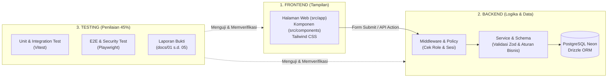

# Panduan Arsitektur & Pembagian Modul

Dokumen ini menyederhanakan struktur proyek menjadi 3 kelompok terpisah: **Frontend**, **Backend**, dan **Testing**, agar mudah dipahami dan dibagi tugasnya dalam tim.

---

## 🎨 1. KELOMPOK FRONTEND (Antarmuka & Pengalaman Pengguna)

Frontend berfokus pada **tampilan visual, navigasi, dan interaksi pengguna**. Di sini tidak ada logika bisnis database langsung; frontend hanya memanggil fungsi backend.

### Struktur Folder
```text
src/
├── app/                          # Routing halaman (Next.js App Router)
│   ├── (publik)/                 # Halaman tamu (belum login)
│   │   ├── page.tsx              # Beranda klinik
│   │   ├── masuk/page.tsx        # Login (pasien / admin)
│   │   └── daftar/page.tsx       # Registrasi pasien baru
│   │
│   ├── (pasien)/                 # Area khusus Pasien (Mobile-first, usia 40-65 th)
│   │   ├── beranda/page.tsx      # Dasbor ringkasan pasien
│   │   ├── profil/page.tsx       # Data diri & riwayat hipertensi
│   │   ├── janji/page.tsx        # Pemesanan slot dokter & status janji
│   │   ├── antrian/page.tsx      # Nomor antrian langsung (real-time)
│   │   ├── kebiasaan/page.tsx    # Pencatatan air minum & pola tidur
│   │   └── notifikasi/page.tsx   # Pesan usulan perubahan jadwal dari admin
│   │
│   ├── (admin)/admin/            # Area khusus Staf Klinik / Admin (Desktop-friendly)
│   │   ├── slot/page.tsx         # Manajemen jadwal & kuota praktik dokter
│   │   ├── antrian/page.tsx      # Pemanggilan & pembaruan status antrian pasien
│   │   ├── usulan/page.tsx       # Form pengajuan ubah/batal jadwal pasien
│   │   └── audit-log/page.tsx    # Catatan riwayat aksi staf (transparansi)
│   │
│   └── layout.tsx                # Kerangka induk (Navbar, Footer, Font)
│
└── components/                   # Komponen UI siap pakai (Reusable)
    ├── button.tsx                # Tombol seragam
    ├── card.tsx                  # Wadah kartu informasi
    ├── input.tsx                 # Form isian dengan pesan error
    └── badge.tsx                 # Label status (misal: "Menunggu", "Selesai")
```

### Karakteristik & Teknologi Frontend
- **Styling**: Tailwind CSS (Utility classes yang rapi dan konsisten).
- **Pendekatan Desain**:
  - Pasien: Font jelas, kontras tinggi, tombol besar (ramah untuk pasien paruh baya).
  - Admin: Tabel data padat, responsif untuk layar komputer meja/klinik.
- **Fase Tugas Terkait**: **Fase F3 (Tugas C01 s.d. C10)**.

---

## ⚙️ 2. KELOMPOK BACKEND (Logika Bisnis, Autentikasi & Database)

Backend menangani **aturan main sistem, validasi keamanan, otorisasi peran, dan penyimpanan data**. Setiap fitur dipisahkan ke dalam modul mandiri di `src/modules/`.

### Struktur Folder
```text
src/
├── db/                           # Layer Database
│   ├── schema/                   # Definisi tabel PostgreSQL (Drizzle ORM)
│   │   ├── users.ts              # Tabel pengguna & peran (pasien, admin)
│   │   ├── slots.ts              # Tabel slot praktik dokter
│   │   ├── appointments.ts       # Tabel janji kontrol
│   │   └── audit-logs.ts         # Tabel log audit append-only
│   ├── migrations/               # Berkas migrasi database otomatis
│   └── seed/                     # Pengisian data dummy untuk demo/pengujian
│
├── modules/                      # Domain Logika Bisnis (Satu fitur = Satu folder)
│   ├── auth/                     # Sesi login, hash password bcrypt, guard role
│   ├── janji/                    # Validasi anti-bentrok slot, reservasi janji
│   ├── antrian/                  # Pembangkit nomor antrian & transisi status
│   ├── notifikasi/               # Notifikasi ke pasien jika admin mengubah jadwal
│   ├── audit/                    # Pencatatan aksi admin yang tidak bisa dimanipulasi
│   └── kebiasaan/                # Validasi catatan minum dan tidur harian
│
├── lib/                          # Fungsi Bantuan Bersama
│   ├── db.ts                     # Inisialisasi koneksi Neon PostgreSQL
│   ├── env.ts                    # Pembacaan environment variable (.env) aman
│   ├── waktu-wib.ts              # Standarisasi zona waktu Asia/Jakarta (WIB)
│   └── errors.ts                 # Penanganan error standar
│
└── middleware.ts                 # Satpam rute: cegah pasien masuk /admin & sebaliknya
```

### Pola 4 Berkas di Setiap Modul Backend (Contoh: `modules/janji/`)
1. **`janji.schema.ts`**: Skema validasi input (menggunakan Zod). Memastikan input tidak kosong atau salah tipe.
2. **`janji.policy.ts`**: Aturan hak akses. (Contoh: "Apakah user ini admin? Apakah janji ini milik pasien yang bersangkutan?").
3. **`janji.repository.ts`**: Kueri SQL ke PostgreSQL via Drizzle ORM (insert, update, select).
4. **`janji.service.ts`**: Logika utama yang menggabungkan validasi, policy, dan repository dalam transaksi database aman.
- **Fase Tugas Terkait**: **Fase F1 (Data A10–A16) & Fase F2 (Backend B01–B13)**.

---

## 🧪 3. KELOMPOK TESTING (Pengujian & Bukti Nilai 45%)

Kelompok ini adalah **inti penilaian mata kuliah IPL**. Seluruh aturan aplikasi dibuktikan dengan pengujian terotomatisasi, bukan sekadar "diasumsikan jalan".

### Struktur Folder
```text
tests/                            # Kode Pengujian Otomatis
├── integration/                  # Uji integrasi API & skenario database riil
│   ├── slot-rebutan.test.ts      # Uji 2 pasien memesan 1 slot secara bersamaan
│   └── transisi-antrian.test.ts  # Uji urutan antrian tidak melompat sembarangan
│
├── system/                       # Uji alur sistem lengkap (End-to-End dengan Playwright)
│   ├── skenario-pasien.spec.ts   # Simulasi pasien login -> pesan janji -> cek antrian
│   └── skenario-admin.spec.ts    # Simulasi admin buat slot -> panggil antrian -> ubah status
│
└── security/                     # Uji celah keamanan
    ├── role-bypass.spec.ts       # Uji pasien mencoba membuka URL /admin
    └── idor.spec.ts              # Uji pasien A mencoba membaca data pasien B via ubah ID di URL

docs/                             # Berkas Laporan & Bukti Pengujian (Wajib IPL)
├── 01-laporan-unit/              # Bukti hasil `npm test` per fungsi bisnis
├── 02-integration/               # Bukti transaksi database & anti-bentrok
├── 03-system-uat/                # Rekaman video / snapshot Playwright & hasil UAT
├── 04-bukti-security/            # Laporan bukti tidak tembus celah role bypass
└── 05-bukti-performa/            # Hasil uji beban latensi p95 (ringan)
```

### Jenis-Jenis Pengujian
1. **Unit Test (Vitest)**: Berdampingan di folder modul (misal: `janji.service.test.ts`). Menguji fungsi logika dalam hitungan milidetik.
2. **Integration Test (Vitest + DB Test)**: Memastikan kueri database berjalan benar tanpa data ganda.
3. **End-to-End Test (Playwright)**: Robot membuka browser Chromium sungguhan, mengisi form, menekan tombol, dan memverifikasi hasil visual.
- **Fase Tugas Terkait**: **Fase F4 (Pengujian D01–D05) & F5 (Penerimaan E01–E03)**.

---

## 🗺️ Ringkasan Alur Kerja



---

## 📌 Rekomendasi Pembagian Kerja Tim

Jika dikerjakan bersama kelompok:
* **Anggota 1 (Fokus Frontend & UI/UX)**: Mengelola halaman di `src/app/`, komponen UI di `src/components/`, memastikan tampilan rapi di mobile & desktop (Fase F3).
* **Anggota 2 (Fokus Backend & Database)**: Mengelola skema tabel di `src/db/` dan aturan logika di `src/modules/` (Fase F1 & F2).
* **Anggota 3 (Fokus Pengujian & Dokumentasi)**: Menjalankan skrip uji di `tests/`, mengecek coverage, dan menyusun laporan bukti di `docs/01-` s.d. `docs/05-` untuk diserahkan ke dosen (Fase F4 & F5).
